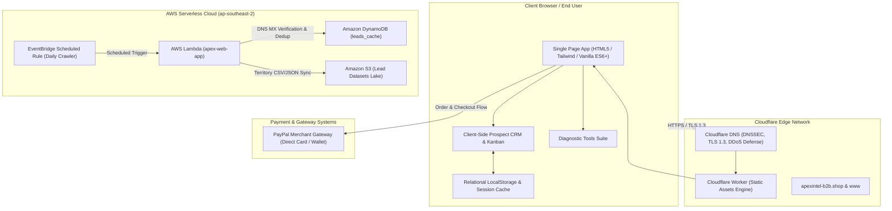
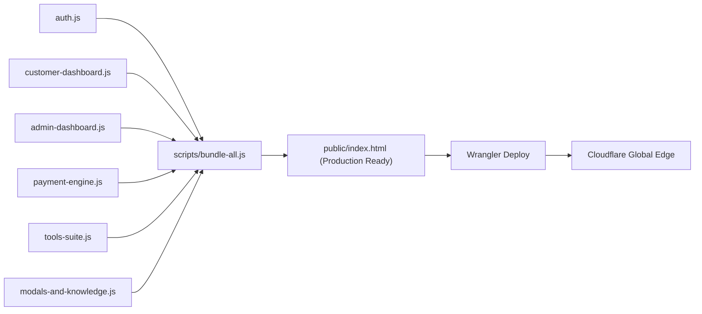

# ApexIntel B2B — Platform Architecture Specification
**Document ID:** `ARCH-2026-v2.0`  
**Classification:** Technical System Architecture  
**Date:** November 22, 2026  

---

## 1. System Architecture Overview

ApexIntel B2B is built on an ultra-low-latency, resilient, and cost-efficient hybrid cloud architecture combining **Cloudflare Workers (Edge Engine)** for static frontend delivery with an **AWS Serverless Backend (Lambda, DynamoDB, EventBridge)** for asynchronous data mining, verification, and lead deduplication.



---

## 2. Frontend Subsystems Architecture

The client application is intentionally designed with zero heavy framework bloat (no React, Next.js, or Vue runtime dependencies) to ensure:
- Sub-500ms initial load times worldwide.
- Flawless offline-first and edge-cached execution.
- Total protection against runtime hydrate crashes and version mismatches.
- High resilience against privacy extension script blocking.

### Core Frontend Subsystem Modules:

```
public/
├── index.html                   # Master SPA shell with dark-first SaaS UI & bundled scripts
├── css/
│   └── (Tailwind Play CDN with dark utility configuration)
└── js/
    ├── auth.js                  # Authentication, session tokens, demo user state
    ├── customer-dashboard.js    # Client Workspace, Prospect CRM, Pipeline, Campaigns, Audit Lab
    ├── admin-dashboard.js       # Executive Command Center, Revenue Metrics, AWS Fleet Monitor
    ├── payment-engine.js        # Dataset catalog, Card modal with auto-format, PayPal checkout
    ├── tools-suite.js           # 6 interactive tools (Scanner, ROI, Outreach, ICP, Catalog, Custom)
    └── modals-and-knowledge.js  # Product detail modals, comparison matrix, 4 outbound playbooks
```

---

## 3. Bundling & Distribution Architecture

To prevent ad-blockers, tracking shields (Brave Shields, uBlock Origin), and network firewalls from blocking scripts named `auth.js` or `tools.js`, a discrete build pipeline compiles all modules directly into `public/index.html`:



---

## 4. State Management & Relational Client Storage

ApexIntel uses structured `localStorage` partitions for high responsiveness, privacy-first data handling, and instant UI state changes without blocking network round-trips:

| Key | Type | Description |
|---|---|---|
| `apexintel_session` | Object | Active user profile, plan tier, remaining credits |
| `apexintel_api_key` | String | Bearer token for CRM and external API integrations |
| `apexintel_crm_leads` | Array | CRM lead database (contact details, status, notes, tags) |
| `apexintel_crm_campaigns` | Array | Active outbound campaigns, target quotas, lead links |
| `apexintel_audit_scans` | Array | Scanned prospect domains, diagnostic audit results |
| `apexintel_custom_requests`| Array | Inbound custom extraction requests and specifications |
| `apexintel_purchases` | Array | Unlocked datasets, download tokens, invoices |

---

## 5. Security Architecture
- **Content Security Policy**: Restricts script execution to approved CDNs (Tailwind, Lucide, FontAwesome).
- **Safe Link Formatting**: External URLs sanitize protocol and use `rel="noopener noreferrer"`.
- **Payment Token Separation**: Credit card inputs do not touch any backend server; formatted client-side and routed securely through PayPal's merchant payment rail.
- **SSRF Hardening**: URL scanner strips dangerous protocols and validates domain structure against RFC standards before execution.
