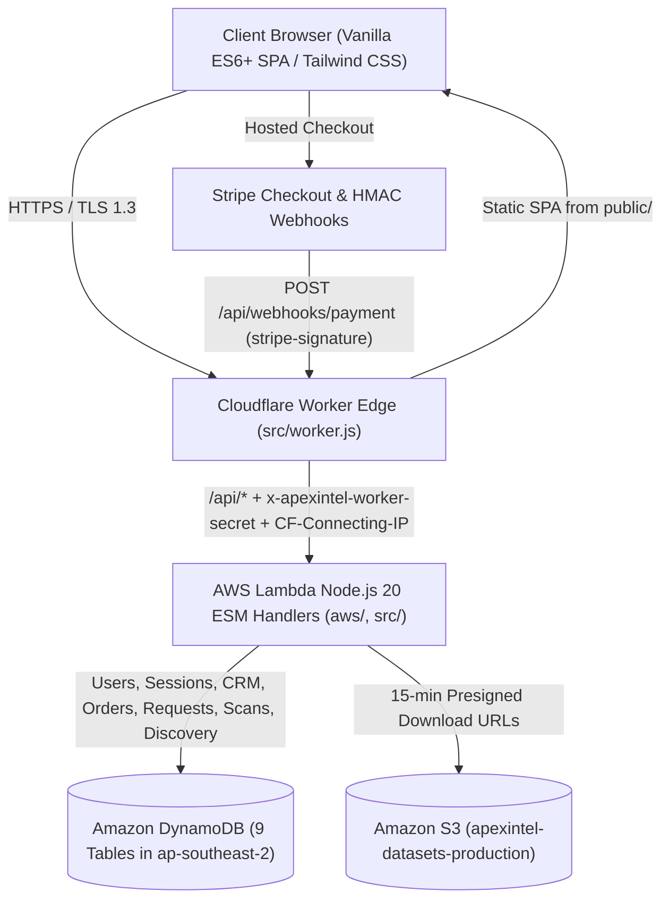

# ApexIntel B2B — Platform Architecture Specification

---

## 1. System Architecture Overview

ApexIntel B2B runs on a hybrid serverless stack combining **Cloudflare Workers** (`src/worker.js`) for edge security and static SPA hosting with **AWS Lambda (Node.js 20 ESM)**, **Amazon DynamoDB**, **Amazon S3**, and **Stripe**.

---

## 2. Frontend Layer (`public/`)

The client is built with modular Vanilla JavaScript (ES6+) and Tailwind CSS (zero React/Next.js/Vue runtime overhead), compiled into `public/index.html` via `scripts/bundle-all.js`:

- `public/js/auth.js`: Cookie-backed authentication (`/api/auth/*`), dynamic navbar, auth modal.
- `public/js/customer-dashboard.js`: 10-tab customer workspace, 11-stage CRM, Kanban/Table views, custom requests, S3 downloads.
- `public/js/admin-dashboard.js`: Role-gated admin command center for custom research queue and operations.
- `public/js/payment-engine.js`: Dataset checkout initiation (`/api/orders/checkout`) and order status flows.
- `public/js/tools-suite.js`: Website scanner (`/api/tools/scan-website`), ROI calculator, outreach generator, ICP scorer, dataset preview, custom request estimator.
- `public/js/modals-and-knowledge.js`: Product detail modals, dataset comparison matrix, playbooks, policy modals.
- `public/css/apex-tokens.css`: Standardized Dark Obsidian CSS design tokens.

---

## 3. Edge Proxy Layer (`src/worker.js`)

- Intercepts `/api/auth/*`, `/api/crm/*`, `/api/orders*`, `/api/webhooks/*`, `/api/downloads/*`, `/api/discovery/*`, `/api/admin/*`, `/api/tools/*`, `/api/requests/*`.
- Fails closed with `404 JSON` on unknown `/api/*` paths.
- Injects `x-apexintel-worker-secret` (`env.WORKER_BACKEND_SECRET`) and overwrites `X-Forwarded-For` with `CF-Connecting-IP`.
- Preserves raw request body for Stripe webhook cryptographic verification and preserves `Set-Cookie` headers.
- Applies security headers (`X-Content-Type-Options: nosniff`, `X-Frame-Options: DENY`, `Strict-Transport-Security`, `Referrer-Policy`, `Content-Security-Policy`).

---

## 4. Compute & Service Modules (`src/`, `aws/`)

- `aws/lambda-auth-handler.mjs` — Lambda Function URL / API Gateway v2 entry handler for authentication.
- `src/auth/` — Scrypt password hashing, SHA-256 session tokens in `HttpOnly` cookies, CSRF origin/token checks, rate limiting, audit logging.
- `src/crm/` — Multi-tenant prospect CRUD, pipeline stage validation, notes, tags.
- `src/payments/` — Server-authoritative catalog (`catalog.js`), Stripe Checkout session creation, HMAC-SHA256 webhook fulfillment, idempotent order records, 15-minute S3 presigned URL generation.
- `src/discovery/` — Discovery search & filtering over `leads_cache` + crawler ingestion endpoints.
- `src/tools/` — SSRF-hardened (`ssrf-guard.js`) live TLS/TTFB/DNS MX/ad-pixel website diagnostic scanner with DynamoDB scan caching.
- `src/requests/` — Custom research pricing calculation, request intake, and admin lifecycle queue (`Submitted` -> `Reviewing` -> `Mining` -> `Delivered`).

In local development (`node serve.js`) and automated tests (`USE_MOCK_STORAGE=true`), each repository transparently supports isolated in-memory adapters.
