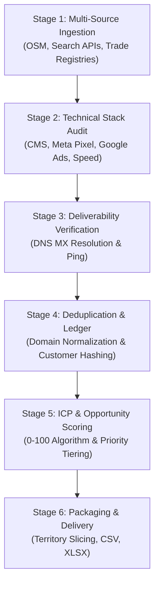

# ApexIntel B2B — Data Extraction, Validation & Packaging Pipeline
**Document ID:** `DATA-PIPE-2026-v2.0`  
**Classification:** Data Engineering Specification  
**Architecture:** 6-Stage Asynchronous Pipeline  

---

## 1. Pipeline Overview

The ApexIntel B2B Data Pipeline automates the collection, technical auditing, deliverability verification, deduplication, and packaging of B2B company records.



---

## 2. Stage-by-Stage Architecture

### Stage 1: Multi-Source Ingestion
- **Target Sectors:** Commercial Roofing, Solar Contractors, Medical Spas, Commercial HVAC.
- **Harvesting Engines:**
  - `test-osm.js` / OpenStreetMap Overpass API: Geographically bounded bounding boxes for Texas, Florida, California.
  - Industry licensing boards & contractor registries: State licensing databases.
  - Search indexes: Direct queries for specialized commercial service providers.
- **Initial Normalization:** Extraction of Company Name, Street Address, Phone, Website URL, Primary Trade Category.

### Stage 2: Technical Stack & Website Audit
For each candidate domain, the pipeline executes a lightweight headless inspection:
- **Response Latency (`speed_ms`):** Time-to-first-byte (TTFB) and DOM load latency in milliseconds.
- **CMS Fingerprinting:** Inspection of HTML headers and meta tags (`WordPress`, `Shopify`, `Webflow`, `Squarespace`, `Custom / NGINX`).
- **Advertising Tracking Tag Detection:**
  - `meta_pixel`: Regex search for `connect.facebook.net/en_US/fbevents.js` or `fbq('init'`.
  - `google_ads`: Regex search for `googletagmanager.com` or `gtag('config', 'AW-`.
- **Strategic Angle:** Contractors running Google Ads but lacking Meta retargeting pixels represent high-value leads for marketing agencies selling conversion-rate optimization.

### Stage 3: Deliverability & DNS MX Verification
To maintain our 99%+ deliverability guarantee, every email domain undergoes authoritative DNS resolution via Node.js `node:dns/promises`:
```javascript
import dns from 'node:dns/promises';

export async function verifyEmailDomain(email) {
  try {
    const domain = email.split('@')[1];
    if (!domain) return false;
    const mxRecords = await dns.resolveMx(domain);
    return Array.isArray(mxRecords) && mxRecords.length > 0;
  } catch (err) {
    return false; // Domain has no valid mail exchanger
  }
}
```
Any record failing MX resolution is automatically discarded from commercial datasets.

### Stage 4: Deduplication & Territory Ledgers
- Master records are indexed by canonical Fully Qualified Domain Name (e.g. `dallasroofer.com`).
- The deduplication engine (`aws/deduplication-engine.mjs`) cross-references each candidate lead against the `delivered_to` customer email history.
- Prevents selling duplicate leads to the same agency across renewals or multi-territory expansion packs.

### Stage 5: ICP & Opportunity Scoring (0-100 Algorithm)
Every lead receives a deterministic Opportunity Score based on quantifiable technical and commercial factors:

$$\text{Score} = \text{Base}(20) + S_{\text{MX}}(25) + S_{\text{Phone}}(15) + S_{\text{AdsGap}}(20) + S_{\text{Latency}}(10) + S_{\text{CMS}}(10)$$

| Factor | Condition | Points Awarded |
|---|---|---|
| **Authoritative MX** | Resolves valid mail exchangers | +25 pts |
| **Direct Phone** | Direct landline or mobile present | +15 pts |
| **Retargeting Gap** | Has Google Ads active, but missing Meta Pixel | +20 pts |
| **Site Speed Opportunity** | Load speed > 1000ms (clear agency pitch) | +10 pts |
| **Modern CMS** | WordPress / Custom setup requiring maintenance | +10 pts |

- **Tier P1 (High Priority - Score 80-100):** Prime target for immediate agency outreach.
- **Tier P2 (Moderate Priority - Score 60-79):** Solid secondary opportunity.
- **Tier P3 (Standard Priority - Score < 60):** Requires additional enrichment.

### Stage 6: Packaging & Delivery
- Validated records are packaged into structured RFC 4180 compliant `.CSV` and `.XLSX` datasets.
- Schema includes: `Company`, `Domain`, `Contact Email`, `Phone`, `Address`, `City`, `State`, `Zip`, `Website Speed`, `CMS`, `Meta Pixel`, `Google Ads`, `MX Status`, `Opportunity Score`, `Pitch Angle`.
