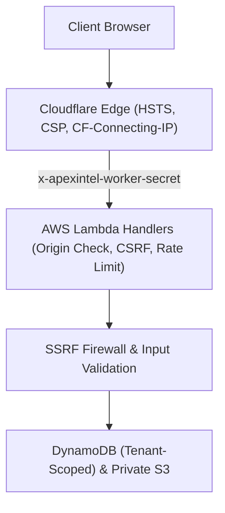

# ApexIntel B2B — Information Security & Compliance Architecture

---

## 1. Defense-in-Depth Boundary

---

## 2. Authentication, Sessions & CSRF (`src/auth/`)

- **Password Hashing:** `node:crypto` `scrypt` with per-user random salt and constant-time comparison (`timingSafeEqual`). Minimum length 12 characters.
- **Session Storage:** Raw session tokens live exclusively in `HttpOnly`, `SameSite=Lax`, `Secure` (in production) cookies. DynamoDB (`apexintel_sessions`) stores only the SHA-256 `tokenHash`.
- **Role Integrity:** Public registration strictly forces `role = 'customer'`. Admin capabilities validate server-side `user.role === 'admin'`.
- **CSRF & Origin Protection:** Mutating endpoints verify trusted `Origin`/`Referer` headers and double-submit `apexintel_csrf` / `x-csrf-token` validation.
- **Edge-to-Origin Lock:** Production Lambda handlers require `x-apexintel-worker-secret` matching `WORKER_BACKEND_SECRET`, rejecting direct invocation bypasses with `403`.

---

## 3. Payment Security & Fulfillment Integrity (`src/payments/`)

- **Zero Cardholder Footprint (PCI SAQ-A):** Card inputs are never handled by ApexIntel servers. Transactions run on Stripe Checkout.
- **Server-Authoritative Pricing:** Checkout sessions look up prices and S3 keys strictly from `APEX_PRODUCT_CATALOG` (`src/payments/catalog.js`), ignoring client-submitted prices.
- **Cryptographic Webhook Verification:** `POST /api/webhooks/payment` validates `stripe-signature` HMAC-SHA256 over the raw payload, validates `session.id`, `amount_total`, and `currency`, and enforces idempotent event deduplication.
- **Gated S3 Delivery:** Presigned URLs (15-minute expiry) are generated only when `order.status === 'paid'` and `order.userId === sessionUser.userId`.

---

## 4. SSRF & XSS Protections (`src/tools/ssrf-guard.js`, `public/js/`)

- **SSRF Guard:** Blocks non-HTTP(S) schemes, `localhost`, `127.0.0.0/8`, RFC 1918 private IPv4 (`10.0.0.0/8`, `172.16.0.0/12`, `192.168.0.0/16`), link-local / cloud metadata (`169.254.0.0/16`), `0.0.0.0`, IPv6 loopback (`::1`, expanded variants), IPv6 ULA/link-local, and DNS-resolved private IPs. Validates TLS trust chains cleanly without falling back to mocked diagnostics.
- **DOM XSS Defense:** User-supplied text rendered into HTML templates passes through `escapeHTML()` encoding `&`, `<`, `>`, `"`, and `'`.

---

## 5. B2B Data Compliance

- Strictly Business-to-Business contact records from publicly accessible websites and commercial registries.
- Outbound workflows must follow CAN-SPAM and applicable B2B regulations.
