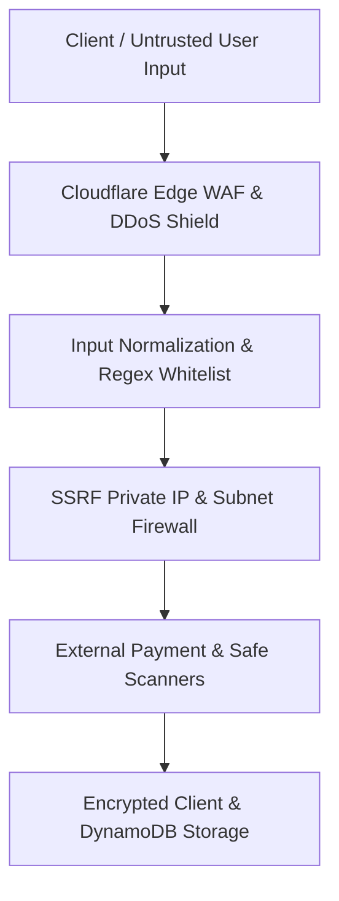

# ApexIntel B2B — Information Security & Compliance Architecture
**Document ID:** `SEC-2026-v2.0`  
**Classification:** Security Assessment & Compliance Blueprint  
**Review Cycle:** Semi-Annual  

---

## 1. Security Principles & Threat Model

ApexIntel B2B processes business contact intelligence, executes diagnostic domain scans, and facilitates high-value commercial transactions. The platform enforces a defense-in-depth security model:



---

## 2. Server-Side Request Forgery (SSRF) Defense

The Website Intelligence Scanner allows users to input target company URLs for diagnostic evaluation. To prevent attackers from probing internal networks, local loopbacks, or cloud metadata endpoints, strict SSRF defenses are implemented:

### Blocked Target Addresses:
- `127.0.0.0/8` (Localhost loopback)
- `10.0.0.0/8`, `172.16.0.0/12`, `192.168.0.0/16` (RFC 1918 Private networks)
- `169.254.169.254` (AWS EC2 / IMDSv2 Instance Metadata Service)
- `0.0.0.0`, `localhost`, `[::1]` (IPv6 loopback)
- Non-web protocols: `file://`, `gopher://`, `ftp://`, `ssh://`, `dict://`

### Validation Algorithm:
```javascript
function validateTargetDomain(inputUrl) {
  try {
    let clean = inputUrl.trim().toLowerCase();
    if (!clean.startsWith('http://') && !clean.startsWith('https://')) {
      clean = 'https://' + clean;
    }
    const parsed = new URL(clean);
    
    // Whitelist only standard web protocols
    if (parsed.protocol !== 'http:' && parsed.protocol !== 'https:') {
      throw new Error("Invalid protocol: Only HTTP/HTTPS supported");
    }
    
    // Check against forbidden loopback and metadata hosts
    const host = parsed.hostname;
    if (/^(localhost|127\.|169\.254\.|10\.|192\.168\.|172\.(1[6-9]|2[0-9]|3[0-1])\.)/.test(host)) {
      throw new Error("Forbidden address range");
    }
    
    // Verify valid TLD structure
    if (!host.includes('.') || host.endsWith('.')) {
      throw new Error("Invalid Fully Qualified Domain Name");
    }
    
    return parsed.hostname;
  } catch (err) {
    return null;
  }
}
```

---

## 3. DOM Cross-Site Scripting (XSS) Prevention

All user-supplied content (lead company names, contact notes, custom request text, and campaign titles) is sanitized before rendering in DOM templates:
- **String Escaping Utility:** All interpolated variables pass through an HTML encoder transforming `&`, `<`, `>`, `"`, `'`, and `/` into safe HTML entities.
- **DOM Insertion:** Prefer `textContent` over `innerHTML` for dynamic fields.
- **Event Binding:** Dynamic handlers avoid `eval()` or `new Function()`; event delegation is bound via structured listeners or sanitized ID dispatchers.

---

## 4. Payment Security & Zero-Cardholder Footprint

ApexIntel B2B strictly satisfies **PCI-DSS Level 4 SAQ-A** compliance:
1. **Zero Storage:** Credit card numbers (PANs), CVVs, and expiration dates are **never** transmitted to, processed by, or stored in any database or server controlled by ApexIntel.
2. **Client Validation:** The Credit/Debit Card modal applies Luhn algorithm validation and formatting on the client device strictly for UX feedback.
3. **Gateway Handoff:** Final transaction authorization routes directly to PayPal's hardened payment gateway (`paypal.me/ApexIntelB2B`), ensuring that all sensitive payment processing occurs on PayPal's PCI Level 1 certified infrastructure.
4. **Download Protection:** Dataset downloads remain locked until an active payment token or confirmed transaction ID is registered in the session ledger.

---

## 5. Regulatory & B2B Data Privacy Compliance

### 5.1 CAN-SPAM Act Compliance (United States)
- All contact records curated by ApexIntel originate from publicly accessible business domains, state commercial registries, and professional directories.
- Data records include business email, business phone, physical business address/territory, and company name.
- Outbound playbooks include mandatory opt-out instructions and physical postal address footer templates to ensure customers remain 100% CAN-SPAM compliant.

### 5.2 GDPR / CCPA Compliance (B2B Legitimate Interest)
- ApexIntel curates strictly **Business-to-Business (B2B)** company contacts; consumer personal data is never mined.
- Data subjects have the immediate right to erasure: any business owner requesting domain removal via `support@apexintel-b2b.shop` is permanently blacklisted in DynamoDB `leads_cache` within 24 hours.
