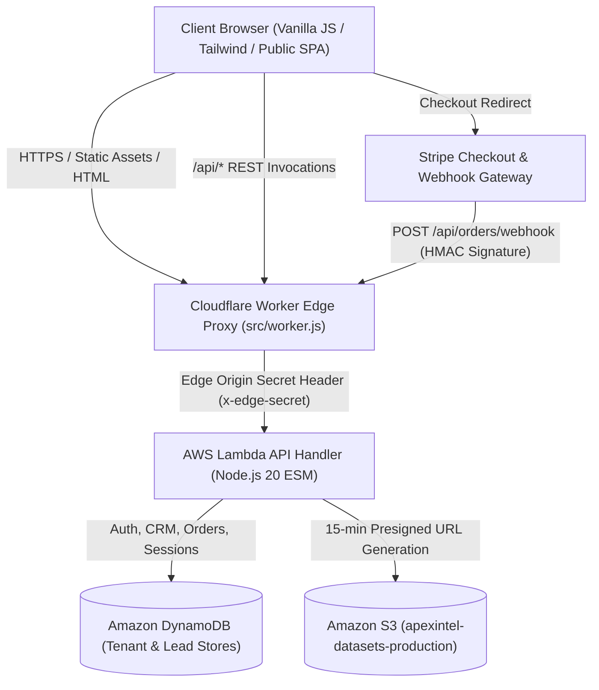

# APEXINTEL — ARCHITECTURE & DATA FLOW MAP (PHASE 0)

## System Overview Diagram

---

## 1. Edge Proxy Layer (`src/worker.js`)
- Enforces origin verification using `APEX_EDGE_ORIGIN_SECRET`.
- Validates allowed HTTP methods (`GET`, `POST`, `OPTIONS`).
- Injects mandatory security headers:
  - `Content-Security-Policy: default-src 'self' ...`
  - `Strict-Transport-Security: max-age=31536000; includeSubDomains; preload`
  - `X-Content-Type-Options: nosniff`
  - `X-Frame-Options: DENY`
  - `Referrer-Policy: strict-origin-when-cross-origin`
- Implements edge-level IP rate limiting via Cloudflare Workers KV/Memory.

---

## 2. Compute Handlers (AWS Lambda Node.js 20 ESM)
- `aws/lambda-auth-handler.mjs`: Primary auth controller handling registration, login, logout, password reset, and session verification.
- `src/crm/router.js` & `service.js`: Manages prospect pipelines, status shifts (`lead` &rarr; `closed`), stage transitions, lead notes, and tags.
- `src/payments/router.js` & `service.js`: Handles Stripe Checkout session generation, HMAC webhook verification, and atomic order state transitions.
- `src/requests/router.js` & `service.js`: Processes bespoke research requests, validation schemas, and lifecycle queues.
- `src/tools/router.js` & `scanner-service.js`: Provides live DNS MX lookups, SSL certificate audits, and anti-SSRF domain diagnostics.

---

## 3. Data Persistence Models (DynamoDB Schemas)
- `apexintel_users`: `userId` (PK), `email` (GSI), `passwordHash`, `role`, `credits`, `company`, `targetNiche`.
- `apexintel_sessions`: `tokenHash` (PK), `userId`, `expiresAt` (TTL), `createdAt`, `userAgent`, `ip`.
- `apexintel_orders`: `orderId` (PK), `userId` (GSI), `productKey`, `amountInCents`, `currency`, `stripeSessionId` (GSI), `status`, `s3Key`.
- `apexintel_leads`: `leadId` (PK), `userId` (GSI), `domain`, `company`, `phone`, `email`, `status`, `score`, `auditSummary`.
- `apexintel_custom_requests`: `requestId` (PK), `userId` (GSI), `industry`, `targetQuantity`, `criteria`, `status`, `createdAt`.
