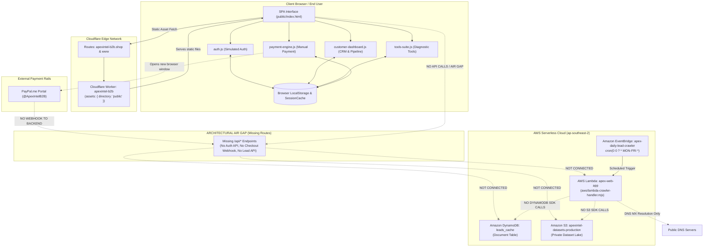

# ApexIntel B2B — Backend Connectivity Map & Data Flow Architecture
**Document ID:** `AUDIT-CONN-2026-v1.0`  
**Classification:** System Topology & Data Flow Verification  
**Date:** November 22, 2026  
**Auditor:** Principal SaaS Architect & Cloud Infrastructure Engineer  

---

## 1. System Topology Overview

This connectivity map models the end-to-end communication channels across the ApexIntel B2B product ecosystem:

$$\text{Customer Browser} \longrightarrow \text{Cloudflare Edge} \longrightarrow \text{Backend APIs} \longrightarrow \text{AWS Lambda} \longrightarrow \text{DynamoDB} \longrightarrow \text{S3}$$

---

## 2. Component Communication Matrix

| Source | Destination | Protocol / Method | Data Exchanged | Implementation Status | Verification Evidence |
|---|---|---|---|:---:|---|
| **Client Browser** | **Cloudflare Worker** | HTTPS / TLS 1.3 (GET) | Static HTML, CSS, JS, Images | **WORKING** | Verified HTTP 200 OK across global edge PoPs. |
| **Client Browser** | **Browser LocalStorage** | Web Storage API | CRM leads, orders, session state | **WORKING (Local Only)** | Trapped in single browser origin; zero server sync. |
| **Client Browser** | **PayPal.me** | HTTPS (Window Open) | Redirection to URL with price | **PARTIALLY WORKING** | Opens payment link; relies on client manual click. |
| **PayPal Gateway** | **Backend Webhook** | HTTPS POST (IPN/Webhook) | Transaction verification, order ID | **NOT IMPLEMENTED** | Zero webhook listeners exist in Cloudflare Worker or AWS. |
| **Client Browser** | **Authentication API** | REST / HTTPS POST | User credentials, JWT tokens | **NOT IMPLEMENTED** | Auth executes purely in client memory (`auth.js`). |
| **Client Browser** | **CRM Sync API** | REST / HTTPS POST | Leads, pipeline status, notes | **NOT IMPLEMENTED** | Zero fetch calls; all data written to `localStorage`. |
| **Client Browser** | **Website Scanner API** | REST / HTTPS POST | Target URL, diagnostic output | **NOT IMPLEMENTED** | Scanner runs client-side `setInterval` simulation. |
| **Client Browser** | **Dataset Download API** | REST / HTTPS GET | Signed S3 URL, dataset archive | **NOT IMPLEMENTED** | Client generates in-memory CSV Blob (6 records). |
| **Cloudflare Worker** | **AWS Lambda** | AWS SigV4 / HTTP | Invocation payload | **NOT IMPLEMENTED** | Worker has no Lambda SDK or API Gateway bindings. |
| **AWS EventBridge** | **AWS Lambda** | AWS Internal RPC | Scheduled cron event | **UNVERIFIED** | Rule exists in AWS config; handler returns in memory. |
| **AWS Lambda** | **Amazon DynamoDB** | AWS SDK (PutItem) | Crawled & verified leads | **NOT IMPLEMENTED** | `aws/lambda-crawler-handler.mjs` lacks DynamoDB client. |
| **AWS Lambda** | **Amazon S3** | AWS SDK (PutObject) | Packaged CSV/XLSX datasets | **NOT IMPLEMENTED** | Handler contains no S3 client calls. |

---

## 3. Detailed Data Flow Deficiencies

### Deficiencies in the Customer Lifecycle:
1. **Onboarding & Registration Flow:**
   - A customer registers via `#authModal`. The account object is appended to `localStorage.getItem('apexintel_accounts')`.
   - **Gap:** No verification email is dispatched. No user record is written to DynamoDB. The account only exists on that specific browser.
2. **Payment & Fulfillment Flow:**
   - A customer orders a $79 Texas Contractors pack. The checkout modal opens PayPal in a separate tab.
   - **Gap:** When the customer returns and clicks *"✓ I Have Completed My Card Payment"*, the browser generates a 6-record CSV Blob from memory. The platform does not verify whether the PayPal transaction succeeded, failed, or was abandoned.
3. **CRM Pipeline Flow:**
   - A customer moves a lead from `New` to `Meeting Scheduled` on the Kanban board.
   - **Gap:** The status change updates `localStorage.getItem('apexintel_crm_leads')`. If the user opens ApexIntel on their laptop, the status change is completely absent.
4. **Custom Extraction Request Flow:**
   - A customer submits a $299 request for 250 solar contractors.
   - **Gap:** The spec is written to `localStorage.getItem('apexintel_custom_requests')`. It is never emailed to the business owner or pushed to a database queue. The administrator only sees it if they log in on the exact same physical browser.
