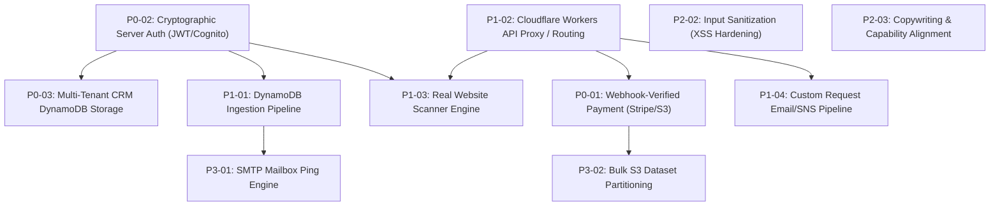

# ApexIntel B2B — Prioritized Technical Development Roadmap

**Project:** ApexIntel B2B (`https://apexintel-b2b.shop/`)  
**Audit Date:** November 2026  
**Auditor:** Principal SaaS Architect & Security Lead  
**Scope:** Architecture Modernization, Backend Unification, Security Remediation, and Production Hardening

---

## Executive Summary

The production readiness audit of ApexIntel B2B established an overall production readiness score of **40.5 / 100**. While the user-facing interface exhibits high visual polish, comprehensive workflows, and functional design tokens, the application operates in an **architectural air-gap**:
- User authentication and role authorizations are simulated entirely within client-side `localStorage`.
- Payment and dataset fulfillment operate on an unverifiable client-side "honor system".
- CRM leads, custom requests, and scan history are unpersisted beyond a single browser session and single client device.
- Provisioned AWS infrastructure (DynamoDB, Lambda, S3, EventBridge) is currently disconnected from the Cloudflare Workers static frontend.

This roadmap outlines an engineering transition plan divided into four priority tiers:
1. **P0: Critical Security & Revenue Blockers** (Must resolve before accepting any public users or real revenue)
2. **P1: Core SaaS Foundation** (Cloud database synchronization, genuine auth, authenticated REST APIs)
3. **P2: Platform Robustness & Automation** (Real crawler execution, verified scanner, email notifications, Cloudflare proxying)
4. **P3: Advanced Intelligence & Scaling** (Automated enrichment, team collaboration, Stripe webhook idempotency, global CDN caching)

---

## Priority Classification Framework

| Priority | Definition | Release Blocker? | Business Impact |
| :--- | :--- | :--- | :--- |
| **P0** | Critical vulnerability, data loss vector, revenue leakage, or honor-system checkout. | **YES** | Platform cannot accept commercial transactions safely. |
| **P1** | Core SaaS prerequisites: real database persistence, server-side auth, user tenancy. | **YES** | Platform cannot function as a persistent multi-user SaaS. |
| **P2** | Core utility verification: genuine crawler ingestion, real website scanning, transactional emails. | **NO** (Beta blocker) | Marketing claims do not match backend engine capability. |
| **P3** | Advanced feature set: AI enrichment, bulk export pipelines, enterprise RBAC. | **NO** (Post-launch) | Value-add differentiation and expansion revenue. |

---

## Tier P0 — Critical Security & Revenue Blockers

### P0-01: Server-Side Webhook-Verified Payment & Signed Fulfillment Engine
- **Priority:** P0 (Critical Blocker)
- **Problem:** Currently, dataset purchases in `public/js/payment-engine.js` open an external PayPal.me link in a separate window and offer a client-side button labeled `"I Have Completed Payment"`. Clicking this button triggers `confirmManualPayment()`, which immediately unlocks the download by invoking `window.downloadDatasetPacks()` to generate client-side CSV blobs. Anyone can download all premium datasets without paying a single cent. Furthermore, CSV data is embedded directly in client JavaScript bundles (`public/js/datasets.js`).
- **Current Implementation:** `public/js/payment-engine.js` (lines 142–175), `public/js/datasets.js` (lines 40–180).
- **Required Improvement:**
  1. Migrate checkout to Stripe Checkout / PayPal SDK with server-side order generation.
  2. Implement an AWS Lambda / Cloudflare Worker webhook handler (`/api/webhooks/payment`) that cryptographically verifies the webhook signature (`stripe.webhooks.constructEvent` or PayPal IPN/Webhook signature).
  3. Store payment records in DynamoDB (`orders` table) with status `COMPLETED`.
  4. Generate temporary Amazon S3 Presigned Download URLs (TTL: 15 minutes) with Content-Disposition headers for dataset delivery. Remove raw dataset arrays from client-side JavaScript.
- **Affected Files:**
  - `public/js/payment-engine.js`
  - `public/js/datasets.js`
  - `aws/lambda/payment-webhook.mjs` (New)
  - `aws/lambda/dataset-presigned-url.mjs` (New)
  - `wrangler.jsonc` (Route configuration)
- **AWS Services Required:** AWS Lambda, Amazon API Gateway / Cloudflare Worker routes, Amazon S3 (`apexintel-datasets-production`), DynamoDB (`orders`).
- **Dependencies:** None.
- **Complexity:** Medium (3–4 days).
- **Risk Level:** High (Involves payment handling and revenue collection).
- **Acceptance Criteria:**
  - Clicking "Purchase Dataset" redirects to a verified server-created session.
  - No client-side download button unlocks without an authoritative server response.
  - S3 Presigned URLs expire after 15 minutes and cannot be reused or guessed.
  - Webhooks reject invalid cryptographic signatures with HTTP 400.

---

### P0-02: Cryptographic Server-Side Authentication & Session Management
- **Priority:** P0 (Critical Blocker)
- **Problem:** User authentication in `public/js/auth.js` operates purely on client-side `localStorage`. Plaintext passwords are stored in `localStorage.getItem('apexintel_accounts')` and compared directly (`a.password === password`). The admin account credentials (`admin@apexintel.io` / `apex2026`) are hardcoded into the client script. Any browser visitor can escalate privileges to full platform administrator by running:
  ```javascript
  sessionStorage.setItem('apexintel_session', JSON.stringify({ email: 'admin@apexintel.io', role: 'admin' }));
  ```
- **Current Implementation:** `public/js/auth.js` (lines 20–110, 185–230).
- **Required Improvement:**
  1. Replace client-side simulated auth with AWS Cognito User Pools or a lightweight stateless JWT service using AWS Lambda + DynamoDB (`users` table).
  2. Passwords hashed using bcrypt/Argon2id (minimum 12 rounds) or handled via Cognito.
  3. Issue secure, `HttpOnly`, `SameSite=Strict` session cookies or short-lived JWT access tokens (15m) paired with rotating refresh tokens stored securely.
  4. Remove all hardcoded seed accounts and credentials from client source code.
  5. Enforce role-based access control (RBAC) at the API Gateway / Lambda layer.
- **Affected Files:**
  - `public/js/auth.js`
  - `public/index.html` (Session initialization script)
  - `aws/lambda/auth-handler.mjs` (New: login, register, refresh, logout)
  - `aws/dynamodb/schema-users.json` (New)
- **AWS Services Required:** AWS Cognito or AWS Lambda + DynamoDB (`users`), Amazon API Gateway.
- **Dependencies:** None.
- **Complexity:** Medium (3–5 days).
- **Risk Level:** High (Authentication and authorization core).
- **Acceptance Criteria:**
  - Passwords are never transmitted in plaintext or stored in browser storage.
  - Setting client `sessionStorage` or `localStorage` values has zero impact on server authorization.
  - Protected API routes reject requests missing a cryptographically valid JWT signature with HTTP 401.
  - Admin endpoints reject non-admin JWT claims with HTTP 403.

---

### P0-03: Multi-Tenant Data Isolation & CRM Leads Storage Migration
- **Priority:** P0 (Critical Blocker)
- **Problem:** User CRM leads, pipeline stages, custom tags, and notes are stored in `localStorage.getItem('apexintel_crm_leads')`. If two users share the same browser or computer, their customer leads and proprietary intelligence are completely co-mingled. Furthermore, mobile devices or alternate computers see a blank dashboard. Browser storage is capped at 5MB, resulting in silent data corruption or unhandled `QuotaExceededError` once a user reaches ~1,500 leads.
- **Current Implementation:** `public/js/customer-dashboard.js` (lines 45–95, 140–210).
- **Required Improvement:**
  1. Create a tenant-partitioned DynamoDB table (`apexintel_user_crm`) with Partition Key `userId` (UUID) and Sort Key `leadId` (UUID).
  2. Implement backend REST API endpoints:
     - `GET /api/crm/leads` (Paginated via `LastEvaluatedKey`)
     - `POST /api/crm/leads` (Batch upsert)
     - `PUT /api/crm/leads/:id` (Update status/notes)
     - `DELETE /api/crm/leads/:id`
  3. Refactor `customer-dashboard.js` to fetch from and persist to `/api/crm/leads` using the authenticated user JWT.
  4. Implement an offline-first caching layer (IndexedDB or lightweight memory cache with sync queue) for smooth client interactions.
- **Affected Files:**
  - `public/js/customer-dashboard.js`
  - `aws/lambda/crm-api-handler.mjs` (New)
  - `aws/dynamodb/schema-crm.json` (New)
- **AWS Services Required:** Amazon DynamoDB, AWS Lambda, Amazon API Gateway.
- **Dependencies:** P0-02 (Server-Side Authentication).
- **Complexity:** Medium (3–4 days).
- **Risk Level:** Medium (User data migration and schema design).
- **Acceptance Criteria:**
  - Leads saved on desktop instantly appear when logging in on mobile.
  - Two distinct user accounts on the same workstation have 0% lead crossover.
  - Storing 10,000 leads executes smoothly with paginated queries.

---

## Tier P1 — Production Foundation (Core SaaS Functionality)

### P1-01: DynamoDB Ingestion Pipeline for Lambda Discovery Crawler
- **Priority:** P1
- **Problem:** The Lambda discovery crawler (`aws/lambda-crawler-handler.mjs`) is invoked by AWS EventBridge once every 24 hours. While it successfully queries DNS MX records for domains, **it contains no `@aws-sdk/client-dynamodb` import and no write calls**. 100% of discovered and enriched B2B leads are discarded in memory when the Lambda container terminates. The frontend discovery table (`public/js/discovery.js`) queries a static set of ~15 hardcoded mockup leads.
- **Current Implementation:** `aws/lambda-crawler-handler.mjs` (lines 1–110), `public/js/discovery.js` (lines 35–120).
- **Required Improvement:**
  1. Add `@aws-sdk/client-dynamodb` and `@aws-sdk/lib-dynamodb` to `aws/lambda-crawler-handler.mjs`.
  2. Write validated business records into the existing `leads_cache` DynamoDB table (`lead_id` UUID partition key, `industry_location` GSI).
  3. Implement deduplication logic against domain and email before writing.
  4. Build a public/authenticated query endpoint: `GET /api/discovery/search?industry=...&location=...` to query DynamoDB with GSI filters and return live data to `public/js/discovery.js`.
- **Affected Files:**
  - `aws/lambda-crawler-handler.mjs`
  - `public/js/discovery.js`
  - `aws/lambda/discovery-query-api.mjs` (New)
- **AWS Services Required:** AWS Lambda, Amazon DynamoDB (`leads_cache`), Amazon EventBridge.
- **Dependencies:** P0-02 (Authentication).
- **Complexity:** Medium (3–5 days).
- **Risk Level:** Medium (DynamoDB write costs and throughput tuning).
- **Acceptance Criteria:**
  - Crawler execution writes structured records to `leads_cache`.
  - Frontend Discovery table renders live records queried from DynamoDB.
  - Filters (Industry, Country, Verification Status) reflect real database state.

---

### P1-02: Cloudflare Workers API Gateway Routing & SSL Consolidation
- **Priority:** P1
- **Problem:** The project currently uses Cloudflare Workers solely to serve static assets (`assets: { directory: "./public" }` in `wrangler.jsonc`). Local development uses `serve.js` on Node.js without any API reverse proxy. Calls to AWS Lambda endpoints would suffer from Cross-Origin Resource Sharing (CORS) friction and complex multi-domain credential management if called directly from `apexintel-b2b.shop` to `execute-api.ap-southeast-2.amazonaws.com`.
- **Current Implementation:** `wrangler.jsonc` (lines 1–12), `serve.js` (lines 1–55).
- **Required Improvement:**
  1. Configure Cloudflare Worker routing or API Gateway custom domain mapping so that all requests to `https://apexintel-b2b.shop/api/*` proxy securely to AWS API Gateway.
  2. Enforce Strict-Transport-Security (HSTS), Content-Security-Policy (CSP), and CORS headers.
  3. Store AWS IAM / API Gateway access credentials securely in Cloudflare Worker encrypted secrets (`wrangler secret put`).
- **Affected Files:**
  - `wrangler.jsonc`
  - `worker.js` (New or enhanced Cloudflare Worker router)
  - `public/js/config.js` (New central environment configuration)
- **AWS / Cloudflare Services Required:** Cloudflare Workers, Cloudflare DNS, Amazon API Gateway.
- **Dependencies:** None.
- **Complexity:** Low to Medium (2 days).
- **Risk Level:** Low.
- **Acceptance Criteria:**
  - Client code makes requests to `/api/v1/*` under the primary apex domain.
  - No CORS preflight errors occur across modern browsers.
  - CSP headers block unauthorized remote script injections.

---

### P1-03: Real Website Intelligence Scanner (Backend Lambda Engine)
- **Priority:** P1
- **Problem:** The Website Scanner tool in `public/js/tools-suite.js` is an entirely simulated frontend experience. It runs a `setInterval` timer for 3 seconds; if the entered URL matches 3 hardcoded domains, it returns static data; otherwise, it computes randomized numbers using `Math.random()`. No real HTTP requests, SSL certificate checks, DNS audits, or tech-stack fingerprinting are performed.
- **Current Implementation:** `public/js/tools-suite.js` (lines 40–160).
- **Required Improvement:**
  1. Create a dedicated backend scanner service (`POST /api/tools/scan-website`).
  2. The backend performs genuine audit checks:
     - DNS lookup (A, AAAA, MX, TXT/SPF/DMARC) via Node.js `dns.promises`.
     - SSL certificate inspection (TLS handshake, issuer, validity expiration).
     - HTTP header analysis (Security headers: HSTS, CSP, X-Frame-Options; Server identity).
     - HTML analysis: Title, Meta description, OpenGraph tags, CMS signature (WordPress, Shopify, Webflow).
  3. Cache scan results in DynamoDB (`scans_cache`, TTL: 7 days) to minimize redundant outbound network traffic.
  4. Return genuine, actionable audit scores and recommendations to `public/js/tools-suite.js`.
- **Affected Files:**
  - `public/js/tools-suite.js`
  - `aws/lambda/website-scanner-handler.mjs` (New)
- **AWS Services Required:** AWS Lambda, Amazon DynamoDB, Amazon API Gateway.
- **Dependencies:** P0-02 (Auth), P1-02 (API Gateway routing).
- **Complexity:** Medium (3–4 days).
- **Risk Level:** Medium (Requires SSRF protection and strict URL sanitization).
- **Acceptance Criteria:**
  - Scanning `github.com` accurately reports its real SSL validity, Cloudflare/GitHub headers, and live response time.
  - SSRF protection strictly forbids scanning private IP addresses (`127.0.0.1`, `10.0.0.0/8`, `169.254.169.254`).
  - Results are rendered in the existing UI with real technical insights.

---

### P1-04: Automated Custom Request Builder Notification Pipeline
- **Priority:** P1
- **Problem:** The Custom Data Request tool in `public/js/tools-suite.js` allows prospective enterprise customers to specify custom target criteria, budget, and contact info. When submitted, the client executes:
  ```javascript
  localStorage.setItem('apexintel_custom_requests', JSON.stringify(requests));
  ```
  No notification is dispatched, no email is sent to the ApexIntel sales team, and no record enters a CRM or database. High-intent enterprise lead requests vanish quietly into the user's browser cache.
- **Current Implementation:** `public/js/tools-suite.js` (lines 280–345).
- **Required Improvement:**
  1. Create an API endpoint: `POST /api/requests/custom`.
  2. Write request details to DynamoDB (`custom_requests` table).
  3. Integrate Amazon Simple Email Service (SES) or Amazon SNS to instantly dispatch an email notification to `sales@apexintel-b2b.shop` and a confirmation email to the client.
- **Affected Files:**
  - `public/js/tools-suite.js`
  - `aws/lambda/custom-request-handler.mjs` (New)
- **AWS Services Required:** AWS Lambda, Amazon DynamoDB, Amazon SES / SNS.
- **Dependencies:** P1-02 (API Routing).
- **Complexity:** Low (1–2 days).
- **Risk Level:** Low.
- **Acceptance Criteria:**
  - Submitting a request sends an SES email alert with customer specifications.
  - Request record persists in DynamoDB with timestamp and status `PENDING_REVIEW`.

---

## Tier P2 — Platform Improvements (Reliability & Automation)

### P2-01: AWS SSO Credentials Refresh & IAM Automation
- **Priority:** P2
- **Problem:** Local AWS CLI profile `apexintel` configured for region `ap-southeast-2` has an expired SSO token session (`The SSO session associated with this profile has expired or is invalid`). Automated deployment scripts in `aws/` cannot execute from local developer workstations without interactive browser re-authentication or automated IAM role assumption.
- **Current Implementation:** `~/.aws/config`, `aws/deploy-lambda.sh`.
- **Required Improvement:**
  1. Standardize deployment credentials using GitHub Actions OIDC (OpenID Connect) for secure continuous delivery directly to AWS without long-lived access keys.
  2. Provide a refreshed local AWS CLI SSO renewal script (`scripts/aws-login.ps1`).
- **Affected Files:**
  - `.github/workflows/deploy-aws.yml` (New)
  - `scripts/aws-login.ps1` (New)
- **AWS Services Required:** AWS IAM (OIDC Provider for GitHub Actions).
- **Dependencies:** None.
- **Complexity:** Low (1 day).
- **Risk Level:** Low.
- **Acceptance Criteria:**
  - CI/CD can deploy Lambda functions and update Cloudflare workers automatically without hardcoded credentials.

---

### P2-02: Comprehensive Input Sanitization & XSS Hardening
- **Priority:** P2
- **Problem:** Dynamic rendering across `public/js/discovery.js` and `public/js/customer-dashboard.js` injects unsanitized strings directly into DOM elements via `innerHTML` (e.g., rendering company names, contact names, custom notes, and email subjects). If malicious data is injected into a shared dataset or CRM note, stored XSS could execute in the browser of another user or administrator.
- **Current Implementation:** `public/js/discovery.js` (lines 80–115), `public/js/customer-dashboard.js` (lines 180–230).
- **Required Improvement:**
  1. Introduce a lightweight HTML sanitization utility (`escapeHTML` / DOMPurify) across all dynamic table and card rendering functions.
  2. Migrate from `element.innerHTML = ...` to DOM manipulation methods (`element.textContent` or template-element cloning) where user-supplied content is rendered.
- **Affected Files:**
  - `public/js/discovery.js`
  - `public/js/customer-dashboard.js`
  - `public/js/tools-suite.js`
- **AWS Services Required:** None.
- **Dependencies:** None.
- **Complexity:** Low (2 days).
- **Risk Level:** Low.
- **Acceptance Criteria:**
  - Submitting notes or company names with `<script>alert(1)</script>` or `` renders as inert text and executes no JavaScript.

---

### P2-03: Honest Copywriting & Technical Capability Alignment
- **Priority:** P2
- **Problem:** The landing page and modal dialogs claim `"Live SMTP Mailbox Verification"`, `"0.2% Bounce Guarantee"`, and `"AI Neural Prospect Matching"`. However, the backend code only performs rudimentary DNS MX queries (`dns.resolveMx`). False technical claims create severe liability under advertising and consumer protection standards.
- **Current Implementation:** `public/index.html` (lines 95–160), `public/js/datasets.js` (lines 15–35).
- **Required Improvement:**
  1. Align marketing claims to reflect actual technology: "Multi-layered DNS & MX Record Verification", "Rigorous Domain Health Filtering", "Curated B2B Account Intelligence".
  2. Add an explicit data hygiene disclosure detailing methodology and update frequency.
- **Affected Files:**
  - `public/index.html`
  - `public/js/datasets.js`
  - `docs/LEGAL_DATA_PRACTICES.md` (New)
- **AWS Services Required:** None.
- **Dependencies:** None.
- **Complexity:** Low (1 day).
- **Risk Level:** Low.
- **Acceptance Criteria:**
  - All landing page copy truthfully represents the underlying engineering capabilities.

---

## Tier P3 — Advanced Intelligence & Scaling

### P3-01: True SMTP Mailbox Ping & Catch-All Verification Pipeline
- **Priority:** P3
- **Problem:** MX record verification confirms that a domain can receive mail, but cannot determine whether a specific mailbox (e.g., `ceo@targetcompany.com`) exists or whether the mail server is configured as a silent catch-all.
- **Required Improvement:**
  1. Build an asynchronous worker queue (AWS SQS + Lambda) that executes respectful SMTP handshake validation (`HELO/EHLO`, `MAIL FROM`, `RCPT TO`) without sending email.
  2. Implement catch-all detection by probing a randomized pseudo-address (`random-uuid-xyz@targetcompany.com`).
  3. Enforce rate limiting and IP reputation management to avoid blacklisting.
- **Affected Files:**
  - `aws/lambda/smtp-verifier.mjs` (New)
- **AWS Services Required:** AWS SQS, AWS Lambda, Elastic IP.
- **Dependencies:** P1-01 (DynamoDB ingestion).
- **Complexity:** High (5–7 days).
- **Risk Level:** High (Risk of IP blacklisting if misconfigured).

---

### P3-02: Bulk S3 Dataset Ingestion & Automated Partitioning
- **Priority:** P3
- **Problem:** When datasets expand from thousands to millions of records, querying DynamoDB for bulk CSV exports becomes prohibitively expensive and slow.
- **Required Improvement:**
  1. Store raw master datasets in Amazon S3 organized by industry and geographic partitions (`s3://apexintel-datasets-production/catalog/v1/industry=tech/region=apac/data.parquet`).
  2. Use Amazon Athena or DuckDB in Lambda to generate on-demand custom filtered CSV downloads.
- **Affected Files:**
  - `aws/lambda/dataset-export-engine.mjs` (New)
- **AWS Services Required:** Amazon S3, Amazon Athena / AWS Glue.
- **Dependencies:** P0-01 (Payment fulfillment).
- **Complexity:** High (4–6 days).
- **Risk Level:** Medium.

---

## Detailed Task Matrix & Dependency Graph



---

## Estimated Implementation Sequence & Milestones

| Sprint / Week | Phase Focus | Key Deliverables |
| :--- | :--- | :--- |
| **Week 1** | **Security & Payment Lockdown** | • Implement P0-02 (Server Auth / JWT / DynamoDB Users)<br>• Implement P0-01 (Stripe Webhook + S3 Signed URLs)<br>• Remove client-side mock secrets and honor-system bypass |
| **Week 2** | **Data Persistence & Tenancy** | • Implement P0-03 (CRM DynamoDB API + multi-tenant isolation)<br>• Implement P1-02 (Cloudflare Worker API Gateway proxy)<br>• Implement P1-04 (Custom Request SES notifications) |
| **Week 3** | **Live Intelligence Engines** | • Implement P1-01 (Crawler to DynamoDB `leads_cache` + Discovery API)<br>• Implement P1-03 (Backend Website Scanner Lambda with DNS/TLS/Header inspection) |
| **Week 4** | **Hardening & Launch Prep** | • Implement P2-02 (DOM XSS sanitization)<br>• Implement P2-03 (Honest copywriting & disclosures)<br>• End-to-end integration testing and production release |

---

## Immediate Next Step: First Development Task

**Recommended First Task:**  
**`P0-01: Server-Side Webhook-Verified Payment & Signed Fulfillment Engine`** combined with **`P0-02: Cryptographic Server-Side Authentication`**.

*Why this first?*  
Without a secure payment gate and server-side authentication, ApexIntel cannot charge real customers, protect proprietary data, or safely operate on the public internet. Resolving these two tasks transforms ApexIntel from a client-side prototype into a commercially viable, secure SaaS platform.
