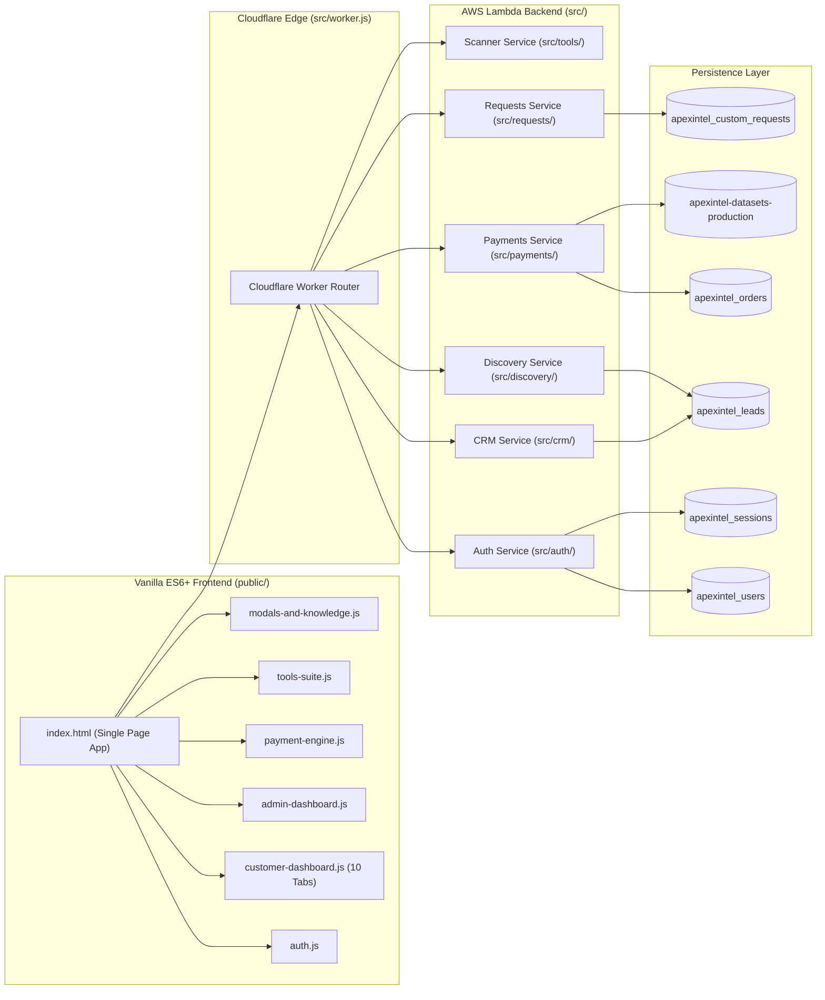

# ApexIntel B2B — Existing Feature Inventory
**Document ID:** `INV-FEAT-2026-V1`  
**Phase:** Phase 1 Product Discovery & Codebase Inspection  
**Date:** November 24, 2026  

---

## 1. Feature Inventory & Component Map

This document catalogues every discrete feature, route, and UI component currently implemented in the ApexIntel platform.

---

## 2. Detailed Subsystem Inventory

### 2.1 Public Experience (`public/index.html`)
- **Hero Section (`#hero`):** Headline, supporting value proposition, primary CTAs (`#tools-suite`, `#catalog`), live intelligence ticker.
- **Intelligence Suite (`#tools-suite`):** Live input field for domain audit, real-time socket inspection, TLS validation, latency gauge, security headers, technology detection.
- **Dataset Catalog (`#catalog`):** Texas, Florida, California, and HVAC dataset cards with price, record count, verification date, sample CSV download, and "Buy Dataset" button.
- **Solutions by Industry (`#solutions`):** Targeted cards for Digital Marketing Agencies, Web Development Agencies, B2B Sales Teams, Lead Generation Agencies, and Business Consultants.
- **Pricing Matrix (`#pricing`):** Product A (Datasets $79–$149 one-time), Product B (Intelligence Workspace $79/mo), and Product C (Custom Research starting $299).
- **Data Provenance & Methodology (`#methodology`):** 5-tier integrity taxonomy (`Verified`, `Publicly Listed`, `Inferred`, `Estimated`, `Unavailable`).
- **FAQ Section (`#faq`):** 8 enterprise B2B questions with expandable answers.
- **Footer:** Navigation links, security disclosures, copyright notice, legal terms modal triggers.

### 2.2 Customer Workspace (`public/js/customer-dashboard.js`)
- **Tab 1: Overview (`#custTab-overview`):** 4 metric cards (Saved Leads, Active Opportunities, High-Priority Leads, Datasets Owned), quick actions, 11-stage pipeline distribution bar, activity stream.
- **Tab 2: Discover (`#custTab-discover`):** Search input, state/territory selector, industry filter, opportunity score badge, "+ Add to CRM" action, "Audit Domain" trigger.
- **Tab 3: My Leads (`#custTab-myleads`):** Saved prospects table, status dropdown filter, priority filter, direct link to lead profile modal.
- **Tab 4: Intelligence (`#custTab-intelligence`):** Full-screen diagnostic scanner with historical scan memory and JSON export.
- **Tab 5: Datasets (`#custTab-datasets`):** Purchased dataset library, active download buttons with 15-minute S3 presigned link generator.
- **Tab 6: Campaigns (`#custTab-campaigns`):** Campaign creation modal, lead list association, outreach cadence status.
- **Tab 7: CRM (`#custTab-crm`):** Kanban & tabular views of 11 pipeline stages, inline note appending, follow-up date scheduling.
- **Tab 8: Custom Research (`#custTab-customreq`):** Intake form with interactive cost calculator, REQ-2026 status board.
- **Tab 9: Billing (`#custTab-billing`):** Active plan details, quota gauges, payment receipt downloads.
- **Tab 10: Settings (`#custTab-settings`):** Profile details, API keys, session logout.

### 2.3 Backend API Endpoints (`src/`)
- `POST /api/auth/register`: Create user account with scrypt password hashing.
- `POST /api/auth/login`: Authenticate credentials, rate-limit, issue HTTP-only cookie.
- `GET  /api/auth/me`: Resolve authenticated session and user profile.
- `POST /api/auth/logout`: Revoke session in DynamoDB and clear cookie.
- `GET  /api/crm/leads`: List tenant's saved prospects (multi-tenant isolated).
- `POST /api/crm/leads`: Create single lead or batch ingest leads.
- `GET  /api/crm/leads/:id`: Point lookup of lead with strict tenant verification.
- `PUT  /api/crm/leads/:id`: Update pipeline stage, append notes, set follow-up.
- `DELETE /api/crm/leads/:id`: Delete lead record.
- `POST /api/orders/checkout`: Initiate Stripe Checkout session for dataset.
- `POST /api/webhooks/payment`: Cryptographically verify Stripe webhook & mark order paid.
- `GET  /api/downloads/signed-url`: Generate time-bound S3 presigned download URL.
- `POST /api/requests/custom`: Submit custom data extraction request.
- `GET  /api/requests/custom`: List customer's submitted research requests.
- `POST /api/tools/scan`: Run live TLS, DNS, latency, and technology audit.
